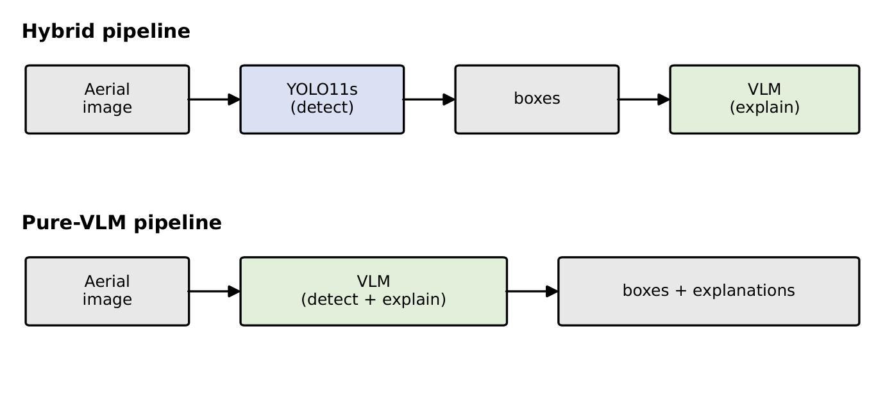
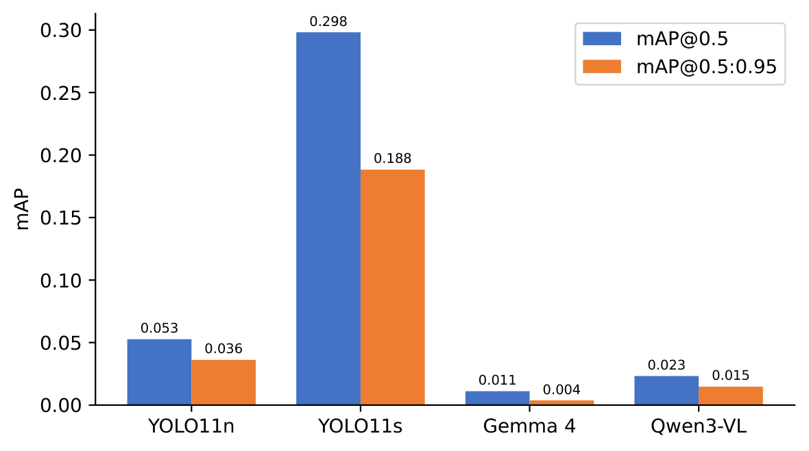
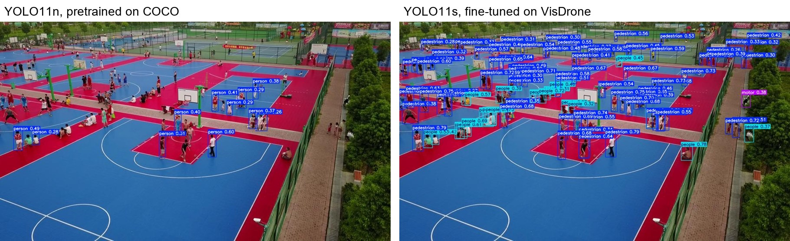
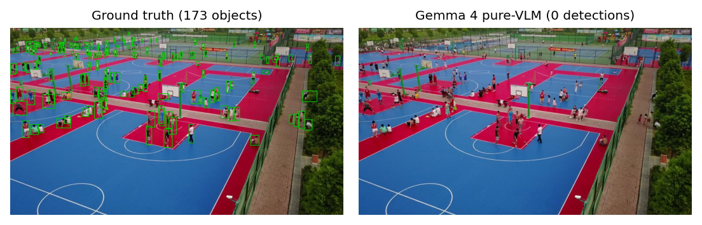
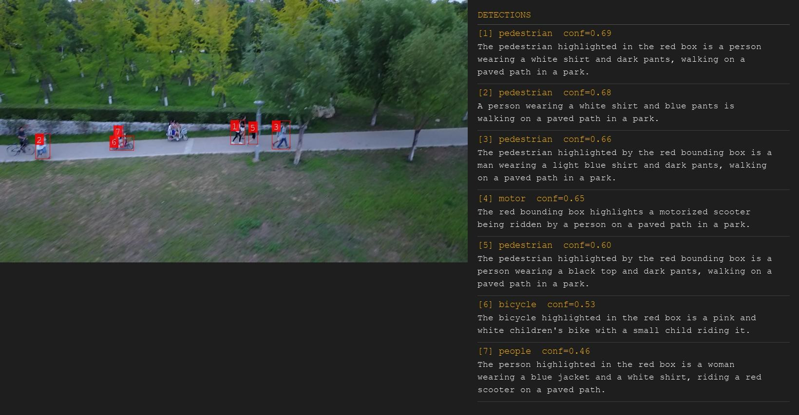
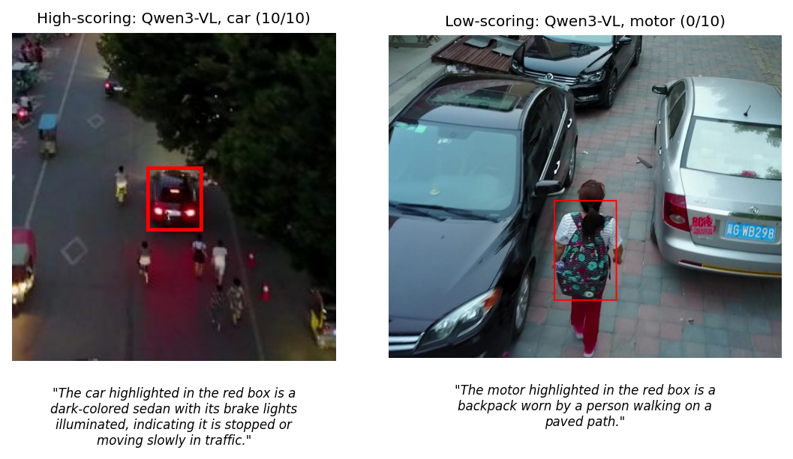
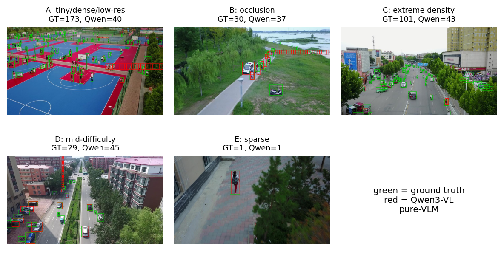

# Drone-Based Object Detection and Explanation Using Vision-Language Models

**Bachelor's thesis, Technical Computer Science, University of Twente · Grade: 8.5**
Deividas Buinevičius · 📄 [Read the paper (PDF)](paper/thesis.pdf)

Can a small Vision-Language Model (VLM) both **find** objects in drone footage and
**explain** what it found in plain language? This project compares two compact VLMs,
**Qwen3-VL-2B** and **Gemma 4 E2B**, with YOLO detectors on the
[VisDrone](https://github.com/VisDrone/VisDrone-Dataset) benchmark.

## Key findings

**VLMs are poor detectors but good explainers.** As standalone detectors they reach
an mAP@0.5 of only 0.011–0.023, against 0.298 for a fine-tuned YOLO11s. Even a YOLO
model that never saw drone images does better. But when YOLO finds the objects and
the VLM only explains them, the explanations are strong: Qwen3-VL scores **8.64/10**
and Gemma 4 **7.69/10** on a five-part rubric, with little hallucination.

The practical takeaway: **keep detection with a specialised model, and call a VLM on
demand to explain a specific detection.**

## Approach

Each VLM is tested in two settings. Comparing the two separates how well a model
*localises* objects from how well it *explains* them.



- **Hybrid:** YOLO11s detects the objects, and the VLM writes an explanation for each box.
- **Pure-VLM:** the VLM detects and explains everything on its own.

| Model | Role |
|---|---|
| YOLO11n, pretrained on COCO | Baseline that has never seen drone images |
| YOLO11s, fine-tuned on VisDrone (50 epochs) | Main detector baseline |
| Qwen3-VL-2B-Instruct | VLM, stronger at spatial tasks |
| Gemma 4 E2B IT | Lightweight comparison VLM |

The study answers three research questions:
1. **RQ1:** How accurately can VLMs localise and classify objects compared with YOLO?
2. **RQ2:** Are their explanations correct, visually grounded and useful?
3. **RQ3:** Under which image conditions do they become unreliable?

## Results

### RQ1: Detection accuracy



| Model | mAP@0.5 | mAP@0.5:0.95 | mAP@0.75 | Recall@0.5 |
|---|---|---|---|---|
| YOLO11n, pretrained (COCO) | 0.053 | 0.036 | 0.039 | 0.067 |
| **YOLO11s, fine-tuned (VisDrone)** | **0.298** | **0.188** | **0.198** | **0.357** |
| Qwen3-VL, pure-VLM | 0.023 | 0.015 | 0.015 | 0.056 |
| Gemma 4, pure-VLM | 0.011 | 0.004 | 0.002 | 0.030 |

Fine-tuning matters a lot for aerial images, where objects are tiny and densely packed.
The VLMs fall far behind both YOLO models:





### RQ2: Explanation quality

In the hybrid setting, 90 explanations per model were scored on visual grounding,
correctness, relevance, absence of hallucination and usefulness (0–2 each, 10 in
total). The full rubric is in [`evaluation/explanation_rubric.txt`](evaluation/explanation_rubric.txt).

| Model | Mean score /10 |
|---|---|
| Qwen3-VL | **8.64** |
| Gemma 4 | 7.69 |

Both models score highest on visual grounding and lowest on correctness and usefulness.
Once a YOLO box anchors them, they rarely invent details.





### RQ3: When the VLMs fail

Reliability depends mainly on **object density and size**. Both models collapse on
tiny, dense, low-resolution scenes and only cope with sparse ones. They also fail in
opposite ways:
- **Gemma 4 is conservative.** It under-detects and draws loose boxes.
- **Qwen3-VL is aggressive.** It finds several times more objects, but also
  hallucinates objects that aren't there.

Neither model gives a usable confidence score to filter its mistakes.



## Repository structure

```
├── paper/
│   ├── thesis.pdf              # The thesis
│   └── latex/                  # LaTeX source and figures
├── src/
│   ├── visdrone_to_coco.py     # Convert VisDrone annotations to COCO format
│   ├── prepare_dataset.py      # Draw ground-truth boxes for inspection
│   ├── run_yolo.py             # YOLO inference on VisDrone val
│   ├── evaluate.py             # mAP and recall with pycocotools
│   ├── compare_models.py       # Side-by-side metric table for all models
│   ├── visualize_explanations.py  # Render boxes with VLM explanations
│   └── class_maps/             # COCO → VisDrone class mapping
├── notebooks/                  # Kaggle notebooks: YOLO training and the four VLM runs
├── models/weights/fine-tuned.pt   # YOLO11s fine-tuned on VisDrone
├── data/
│   ├── coco_gt/                # VisDrone val ground truth in COCO format
│   └── *_images.txt            # Image IDs of the hand-picked RQ2 and RQ3 samples
├── outputs/
│   ├── eval_reports/           # Metrics per model (JSON)
│   ├── YOLO/yolo_predictions/  # Fine-tuned YOLO predictions
│   └── VLM/                    # VLM predictions, explanations and timings
├── evaluation/                 # RQ2 rubric and RQ2/RQ3 scoring sheets
└── docs/images/                # Figures used in this README
```

## Reproducing the results

```bash
pip install -r requirements.txt
```

**Compare all models** from the stored reports. This needs no dataset or GPU:
```bash
python src/compare_models.py --reports-dir outputs/eval_reports
```

**Rerun the evaluation** after downloading the
[VisDrone2019-DET val set](https://github.com/VisDrone/VisDrone-Dataset) to
`data/visdrone_raw/VisDrone2019-DET-val`:
```bash
python src/visdrone_to_coco.py
python src/run_yolo.py --model-path models/weights/fine-tuned.pt --max-images 0 \
    --predictions-path outputs/YOLO/yolo_predictions/yolo_finetuned_predictions.json
python src/evaluate.py --predictions outputs/YOLO/yolo_predictions/yolo_finetuned_predictions.json \
    --gt data/coco_gt/visdrone_val.json --report-out outputs/eval_reports/yolo11s_finetuned_visdrone.json
```

**VLM pipelines.** Run the notebooks in `notebooks/` on Kaggle with a T4 GPU. Gemma 4
needs a Hugging Face token, stored as a Kaggle secret. Put the JSON files they write
into the matching `outputs/VLM/` folder, then render the explanations with:
```bash
python src/visualize_explanations.py --setting hybrid \
    --images-dir data/visdrone_raw/VisDrone2019-DET-val/images
```

## Limitations
- Only 2B-parameter VLMs were tested. Larger models may localise better.
- The RQ2 scores come from a single annotator.
- The RQ2 and RQ3 samples are small (30 and 25 hand-picked images).
- Each setting uses one fixed, hand-written prompt.

## Acknowledgements
Images come from the [VisDrone dataset](https://github.com/VisDrone/VisDrone-Dataset)
(Zhu et al., *Detection and Tracking Meet Drones Challenge*, TPAMI 2021), which is
provided for academic use.
